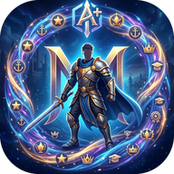
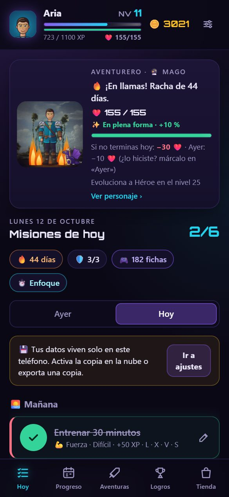
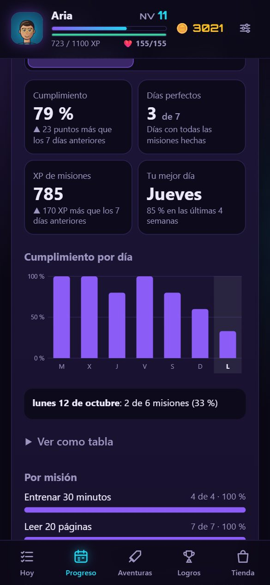
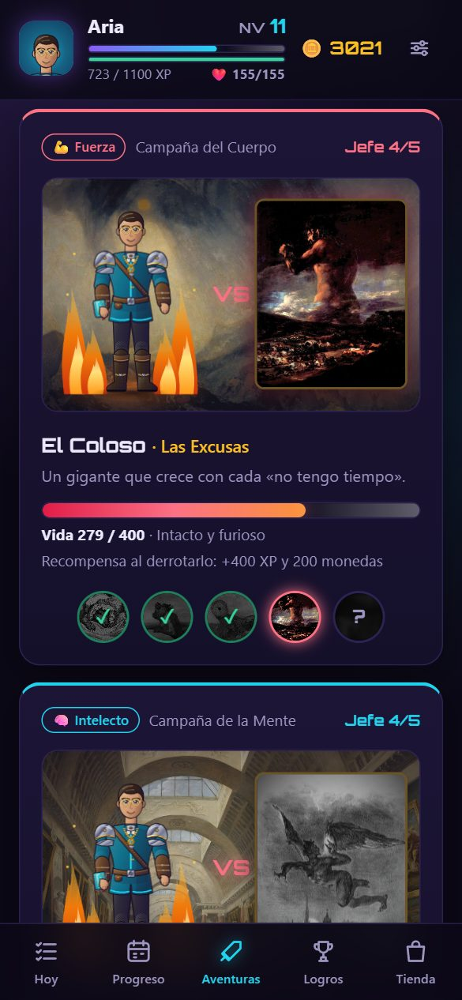
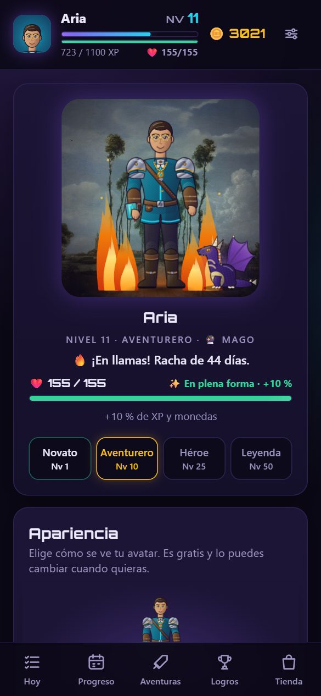
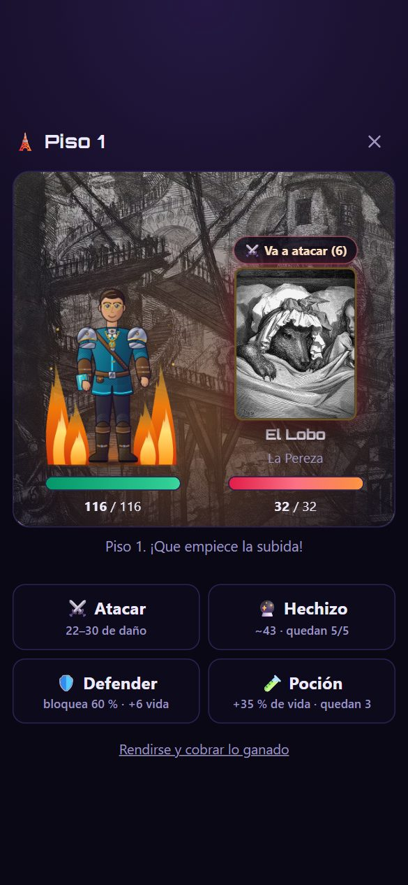

#  Vida RPG

[](https://github.com/MRkevin12/vida-rpg/actions/workflows/pruebas.yml)

[](LICENSE)

Una app de productividad que convierte tu día a día en un juego de rol: completas misiones, ganas experiencia, subes de nivel y derrotas jefes.

Está pensada para el iPhone. Se instala desde Safari o Chrome, funciona sin internet y guarda todo en el teléfono, sin cuentas ni anuncios. Lo único en la nube es un servidor pequeño para las notificaciones y una copia de seguridad **cifrada en el teléfono**, que el servidor no puede leer.

**Abrir la app:** https://mrkevin12.github.io/vida-rpg/

<p>
  
  
  
  
  
</p>

Las capturas usan una partida de ejemplo inventada.

## Qué tiene

- **Misiones diarias** con dificultad, atributo y los días de la semana en que tocan, o **N veces por semana** el día que quieras (sin romper la racha). Las que se cuentan («8 vasos de agua») tienen un botón +1 y se completan solas al llegar a la meta. Se agrupan por **momento del día** (mañana, tarde, noche) y se **ordenan arrastrando**. Si olvidaste marcar algo, puedes marcar el día de ayer.
- **Deslizar para completar** y botón **Deshacer** por si te equivocas.
- **Ficha de cada hábito:** su racha, su mejor racha, el porcentaje del último mes y un calendario de 12 semanas.
- **Tareas sueltas:** pendientes de una sola vez, con o sin fecha. Aparecen en Hoy el día que vencen (y se marcan como atrasadas si pasó la fecha). También se crean desde «Nueva misión» → «Una sola vez».
- **Bienvenida guiada** con hábitos y premios listos para elegir con un toque, y una ventana de **novedades** después de cada actualización.
- **Modo enfoque:** un temporizador de 15, 25 o 50 minutos que da lo mismo que una misión. Sigue contando aunque cierres la app.
- **Diario de una línea:** una frase y tu ánimo de cada día, visibles al tocar el día en el calendario.
- **Desafío de la semana:** uno al azar cada lunes (adaptado a tu partida). Si lo cumples, abres un cofre.
- **Tu semana:** al empezar una semana nueva, un resumen de la anterior: cumplimiento, días perfectos, metas, enfoque, ánimo y el desafío.
- **XP, niveles y cuatro atributos:** Fuerza, Intelecto, Carisma y Riqueza. Además puedes crear **tus propios atributos** para cosas específicas (Programación, Inglés, Salud…): cada uno tiene su nivel y le suma a uno de los 4.
- **Vida del héroe:** al terminar cada día pierdes vida por lo que tocaba y no hiciste, y la recuperas cumpliendo. Con 80 % o más estás **en plena forma** (+10 % de XP y monedas). Si llega a 0 caes en combate: la tienda y el arcade se cierran hasta que recuperes la mitad. Hay **pociones** (una al día) y un **modo descanso** para vacaciones o días enfermo, que no quita vida ni rompe la racha.
- **Rachas con escudos:** cada 7 días seguidos ganas un escudo que salva un día fallado. Los días de descanso no rompen la racha.
- **Resumen con gráficas** de los últimos 7 o 30 días: cumplimiento, días perfectos, XP, tu mejor día de la semana y qué atributo tienes descuidado.
- **Calendario de un año** al estilo de GitHub.
- **Misiones principales** divididas en pasos, para las metas grandes.
- **Campaña de jefes:** cada atributo tiene 5 jefes, cada uno más fuerte, en su propio escenario. Les haces daño cumpliendo misiones de ese atributo: las diarias, las tareas y el enfoque pegan poco y los pasos de una misión principal pegan mucho. Tu héroe ataca con su arma y el jefe recibe el golpe. Al vencer a los 5 empieza la **Partida+**: vuelven con más vida y mejores premios en cada ronda.
- **Logros** automáticos y personales, y una **tienda** donde cambias monedas por recompensas reales que tú defines.
- **Fondos pintados:** los escenarios del avatar y de las batallas son pinturas clásicas de dominio público (Constable, Bierstadt, Van Gogh, Turner, Panini…).
- **Avatar que evoluciona** en 4 etapas, de la túnica de novato a la armadura de leyenda, con clase según tu atributo más alto, equipamiento de distinta rareza y un dragón de mascota. La apariencia se personaliza: cuerpo, piel, rostro, ojos, pelo, barba y color del traje.
- **Torre del héroe:** un minijuego grande de batallas por turnos, piso a piso, con mejoras entre pisos. Tu poder sale de los niveles de tus atributos reales, y subes con tu vida real.
- **Tres minijuegos** más, que se juegan con fichas ganadas al completar misiones.
- **Notificaciones:** recordatorios a las horas y días que elijas (con lo que te falta del día y, de noche, cuánta vida pierdes si no terminas), un aviso propio para cada misión que le pongas hora (solo si todavía no la hiciste) y un aviso cuando termina tu sesión de enfoque. El ícono muestra cuántas misiones te faltan.
- **PIN de 4 números o Face ID** para abrir la app.
- **Copia de seguridad automática en la nube**, cifrada con tu contraseña, además de la copia en un archivo.
- **Sonidos** hechos con código, que se pueden apagar en Ajustes.

## Instalarla en el iPhone

1. Abre https://mrkevin12.github.io/vida-rpg/ en **Safari**.
2. Toca **Compartir** y luego **Agregar a pantalla de inicio**.
3. Abre la app desde el ícono nuevo. Desde ahí funciona sin internet.

Cuando hay una versión nueva, la app muestra un aviso para actualizar. La versión instalada se ve en Ajustes.

También se puede instalar desde **Chrome** en el iPhone (iOS 16.4 o más): botón Compartir → **Agregar a la pantalla de inicio**. La app instalada guarda su partida aparte de la pestaña del navegador: si ya jugabas en una pestaña, exporta la copia ahí e impórtala en la app instalada.

## Notificaciones

Los avisos solo funcionan en la app instalada. Se activan en Ajustes → 🔔 Notificaciones con un código de activación.

Una app web no puede programar avisos por su cuenta, así que hay un servidor pequeño en **Cloudflare Workers** (carpeta `servidor/`). Ese servidor guarda solo la suscripción del teléfono, los horarios y la hora en que termina el enfoque. A la hora indicada envía un aviso que únicamente dice su tipo. El texto lo arma el propio teléfono (`sw.js`) con un resumen que la app deja guardado, así que **tus misiones no salen del iPhone**.

| Archivo | Para qué sirve |
|---|---|
| `js/avisos.js` | Activar, hablar con el servidor y preparar el texto de los avisos de los próximos 7 días |
| `servidor/worker.js` | El servidor: guarda tus horarios y cada minuto revisa si toca un aviso |
| `servidor/webpush.js` | Firma (VAPID) y cifra (aes128gcm) cada aviso, sin librerías |
| `servidor/pruebas.mjs` | Pruebas del servidor (`npm run pruebas`), incluido el ejemplo oficial del RFC 8291 |

Para publicar cambios del servidor, desde `servidor/` y con Node.js instalado: `npm install` (solo la primera vez) y `npm run publicar`. Los secretos (`CODIGO` y `VAPID_PRIVADA`) viven en Cloudflare y en `servidor/.dev.vars`, que no se sube a GitHub.

## Tus datos

Todo se guarda en el teléfono con `localStorage`. Si borras la app, borras tu partida, así que hay dos formas de tener copia:

- **Copia en la nube (automática):** Ajustes → ☁️ Copia en la nube. Una vez al día la app **cifra la partida en el teléfono** con una llave que sale de tu contraseña (PBKDF2 con 210 000 vueltas + AES-GCM) y la sube al servidor. El servidor solo guarda texto ilegible: sin tu contraseña nadie puede abrirla. En un teléfono nuevo: «☁️ Recuperar mi copia de la nube», con el código de activación y la contraseña (`js/nube.js`).
- **Archivo:** Ajustes → Exportar copia. Ese archivo sirve para recuperar la partida o pasarla a otro teléfono.

El PIN (o Face ID, con WebAuthn) evita que alguien con tu teléfono desbloqueado abra la app. No cifra los datos del teléfono: la protección de fondo es el código o Face ID del iPhone.

## Cómo está hecha

HTML, CSS y JavaScript sin librerías ni paso de compilación. Los personajes, objetos y escenarios no son imágenes: se dibujan con código (SVG), por eso se pueden personalizar y animar. Es una PWA: un *service worker* (`sw.js`) guarda los archivos en el teléfono la primera vez para que después abra sin conexión.

La idea central es que casi todo **se calcula a partir del historial** en lugar de guardarse: la racha, los escudos, el calendario, la vida de los jefes, el progreso del desafío semanal y el resumen salen de la lista de misiones completadas. Así no hay números que se puedan desincronizar.

| Archivo | Para qué sirve |
|---|---|
| `index.html`, `estilos.css` | La estructura de la página y su aspecto |
| `js/app.js` | Conecta todo: escucha los toques, ejecuta acciones y redibuja |
| `js/acciones.js` | Lo que cambia la partida: crear, completar, editar, canjear |
| `js/juego.js` | Las reglas: XP, niveles, rachas, logros |
| `js/campana.js` | Los jefes: vida, daño, Partida+ y créditos de las pinturas |
| `js/desafios.js` | El desafío de la semana: cuáles hay, cómo se eligen y cómo se mide el progreso |
| `js/resumen.js` | Los números del resumen de 7 y 30 días y de «Tu semana» |
| `js/vistas.js` | Convierte la partida en HTML |
| `js/avatar.js` | Las reglas del avatar: etapas, clases, objetos y opciones de apariencia |
| `js/dibujo.js`, `js/dibujo-*.js` | El dibujo en SVG: cuerpo, ropa, objetos, escenarios y mascota |
| `js/arcade.js`, `js/minijuegos.js` | Las fichas y los tres minijuegos en `<canvas>` |
| `js/torre.js` | Las reglas de la Torre del héroe (batallas por turnos y mejoras) |
| `js/vida.js` | La vida del héroe: daño, curación, plena forma, caer en combate y pociones (se calcula día por día) |
| `js/pinturas.js`, `fondos/` | Las pinturas de los fondos y escenarios, con sus créditos |
| `js/datos.js` | Guardar, cargar y copias de seguridad |
| `js/seguridad.js` | El PIN (se guarda su huella SHA-256, nunca el PIN) y Face ID con WebAuthn |
| `js/nube.js` | La copia en la nube: cifrar y descifrar con tu contraseña, subir y recuperar |
| `js/plantillas.js`, `js/novedades.js` | Hábitos y premios listos para elegir, y las novedades de cada versión |
| `js/sonido.js` | Sonidos con la Web Audio API |
| `js/fechas.js` | Ayudantes de fechas |
| `sw.js`, `manifest.json` | Funcionar sin internet e instalarse como app |

Para cambiar el balance del juego (cuánta XP da cada cosa, cuánta vida tiene cada jefe) basta con editar las constantes al inicio de `js/juego.js` y `js/campana.js`.

## Ejecutarla en tu compu

Los módulos de JavaScript necesitan un servidor: abrir `index.html` con doble clic no funciona. Con Python instalado:

```bash
git clone https://github.com/MRkevin12/vida-rpg.git
cd vida-rpg
python3 -m http.server 8000
```

Luego abre http://localhost:8000.

Al editar un archivo, recarga la página **dos veces**: el service worker muestra primero la copia guardada y descarga la nueva por detrás.

## Pruebas

Con el servidor encendido, abre http://localhost:8000/pruebas/. La página ejecuta 87 pruebas de las reglas del juego (niveles, atributos propios, rachas, escudos, vida, pociones, modo descanso, días de la semana, misiones semanales y con cantidad, tareas, enfoque, diario, desafíos, jefes y Partida+, Torre del héroe, fichas de hábitos, logros, tienda, resumen, cifrado de la copia en la nube y copias de seguridad) y de los dibujos (que ninguna combinación de avatar se rompa), y muestra cuáles pasan. El servidor tiene 10 pruebas más (`node servidor/pruebas.mjs`).

Las pruebas crean partidas en memoria y nunca tocan la partida guardada. Están en `pruebas/pruebas.js`, y `pruebas/demo.js` genera la partida de ejemplo de las capturas.

**Pruebas automáticas:** cada vez que se suben cambios, GitHub corre todas las pruebas en un navegador sin ventana (`.github/workflows/pruebas.yml` y `pruebas/ejecutar.mjs`). La insignia de arriba dice si pasaron.

## Publicar una versión nueva

1. Sube el número de `VERSION` en `sw.js`. Sin eso, los teléfonos no detectan el cambio.
2. Si agregaste archivos, súmalos a la lista `ARCHIVOS` del mismo archivo.
3. Agrega lo nuevo a `js/novedades.js` (y sube `VERSION_APP` al mismo número) y a `CHANGELOG.md`.
4. `git push`. GitHub Pages publica la rama `main` en uno o dos minutos y GitHub corre las pruebas.

## Créditos

- **Pinturas de los jefes:** 20 obras de dominio público tomadas de Wikimedia Commons (Doré, Caravaggio, Goya, Blake, Waterhouse, Redon y otros). El autor y la fuente de cada una están en la app, en Ajustes → Créditos de las imágenes, y en `js/campana.js`.
- **Fondos y escenarios:** 13 pinturas y grabados de dominio público (Constable, Hobbema, Thomas Cole, Bierstadt, Shishkin, Christian Jank, Van Gogh, Panini, Turner, Hubert Robert, Pieter Neefs y Piranesi), con sus créditos en la app y en `js/pinturas.js`.
- **Tipografía:** Orbitron, bajo la licencia SIL Open Font License (`fuentes/OFL.txt`).

## Licencia

El código está bajo la [licencia MIT](LICENSE). Las pinturas son de dominio público y la tipografía tiene su propia licencia (ver Créditos). Los cambios de cada versión están en el [registro de cambios](CHANGELOG.md).
